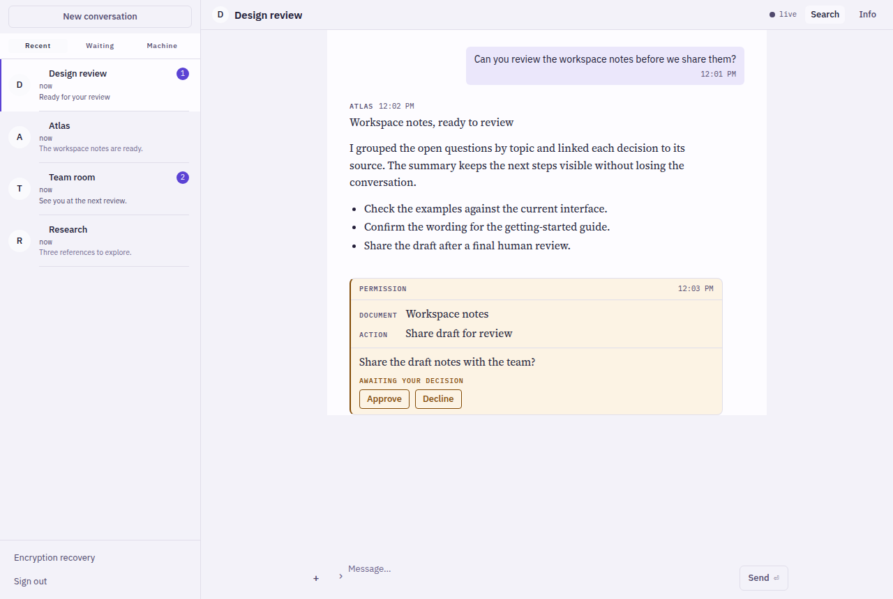

# SuperMessage

[](https://github.com/SuperJackfruitLabs/supermessage/actions/workflows/ci.yml)
[](https://github.com/SuperJackfruitLabs/supermessage/releases/latest)
[](LICENSE)

A cross-platform, agent-aware Matrix chat client for iOS, Android, Windows,
macOS, and Linux. The platforms share a Rust Matrix core: desktop uses
**Tauri 2 + Svelte 5**, iOS uses **SwiftUI**, and Android uses **Kotlin/Compose**
through UniFFI. See [AGENTS.md](AGENTS.md) for the current architecture and
[docs/tech-stack.md](docs/tech-stack.md) for the original decisions.

**[Download desktop](https://github.com/SuperJackfruitLabs/supermessage/releases/latest)** ·
**[Build from source](#building)** ·
**[Development guide](AGENTS.md)** ·
**[Issues](https://github.com/SuperJackfruitLabs/supermessage/issues)**



*Desktop frontend captured in Chromium with synthetic local fixtures. It shows
production UI components; no Matrix account or live conversation was used.
Native window chrome and platform rendering differ.*

## Status: early, with active desktop and native clients

The table describes implemented source paths on this branch, reviewed in
September 2026. It is not a promise that every platform has a current signed
release, or that every operation has been exercised against a live homeserver.

| Capability | Desktop (Linux/macOS/Windows) | iOS | Android |
|---|---|---|---|
| Password login, persistent session, room and timeline sync | Implemented | Implemented | Implemented |
| Messages, replies, reactions, typing and read receipts | Implemented | Implemented | Implemented |
| File/image sending and editing/deleting own messages | Sending, editing and deleting implemented | Implemented | Sending, editing and deleting implemented |
| New conversations, room joining and accepting invitations | Implemented; new conversation lists the people you share rooms with (agents first) and opens the existing DM before creating one; invitations show who invited you | Implemented | Implemented |
| Message search | Homeserver search, this room or all rooms; search is a destination in the sidebar | Homeserver search | Homeserver search |
| Destinations, Needs you inbox, Agents view and roster filters | Implemented; Chats, Needs you (decisions and invitations, with a count of decisions), Agents (status and last activity) and Search above the roster, All and Unread chips with the arrangement menu kept, empty states in iOS's words and space names read as people say them, all from the core. Covered by tests and stories; the 1905px, 600px and 150 % text checks and a real decision lighting the count are pending the owner | Implemented | Not yet |
| Welcome screen and first-run demo | Implemented; a welcome before the first sign-in form, and a one-time sample conversation (a local script, nothing sent to the homeserver) after the first interactive sign-in, once any new recovery key has been shown. Covered by tests and stories; a fresh-profile pass is pending the owner | Implemented | Not yet |
| Appearance settings | Account panel: who is signed in, mode, dark style, accent, text size and the blocked list | Account panel: mode, dark style, accent and roster options | Account panel: identity, mode, dark style, accent, roster order, agent state, blocked list and help links |
| Encryption and key recovery | SDK crypto and recovery UI | SDK crypto and recovery UI | SDK crypto and recovery UI |
| AgentPod turn/permission cards and SuperPipeline gates | Implemented; gate sender uses shared core; permission answers sent through the core's room-addressed sender (`Session::send_permission_answer`, awaits the homeserver; content is ordinary chat text); one live card in the timeline while a turn runs, "What I did" in the answer, a header status pill, a "Sent to" / "is on it" dock and an `@` menu from the room's cast (agents first). Covered by tests and stories; a real agent turn is pending the owner's live pass | Implemented | Implemented; every peer message is a card (agents say "Agent", long answers open in a serif reading view), one live card in the timeline while a turn runs with the history gliding up as it grows, "What I did" in the answer, a header status pill, agent tiles in the roster, and a "Sent to" / "is on it" dock and typing pill over the composer, all from the core. Covered by instrumented tests and previews; a real agent turn and the signed-in device pass are pending the owner |
| Block users and agents; report messages, rooms and users | Implemented; block and unblock from a room's members and the Account panel; report a message, a room (joined or invited) or a member; a reported message is hidden on this device. Live verification pending | Implemented | Implemented (writes not yet exercised against a live account) |
| Voice messages | Recording in the composer, probed on Linux only (a mic when the field is empty: tap, or hold and release to send; the core's recorder numbers and waveform, sent as Ogg/Opus). The webview records with `MediaRecorder`, so Linux needs GStreamer's base and good plugins (the `.deb` and `.rpm` declare them). The mic is hidden wherever the webview's `MediaRecorder` cannot record Ogg/Opus, which is expected on macOS and Windows (not probed there). Covered by tests and stories; recording and sending a note are pending the owner (the Linux machine probed lacks `gst-plugins-good`) | Implemented | Not yet |
| Notifications while the app runs, and the title count | Implemented; the core words each notification and decides when one is news. On Linux a permission or gate notification can be answered from its buttons when the server offers actions, and clicking a notification is meant to open its room (tested end to end against a fake notification server; a live click is pending the owner). On macOS and Windows notifications are informational: clicking one does nothing, and signing out cannot remove them. The window title carries the Needs you count, "(3) supermessage". Covered by tests; a real Approve or click from a notification on KDE and GNOME is pending the owner | Implemented (local notifications and the push extension) | Not yet |
| Tray, working count and "keep running"; turn-ended notification | Implemented on Linux (KDE verified; GNOME without the AppIndicator extension shows no tray). A tray icon carries a Needs you dot, a Needs you line and a working line, all worded by the core; "Keep running in the tray when the window is closed" is an opt-in in Account, offered only where a tray exists, and a second launch brings the hidden window back. The first time the window hides, one notification says the app is still running. When an agent's turn ends with no reply to carry the news, or with a failed step, one notification says so ("Atlas finished" / "Atlas failed"), unless that room is on screen in the focused window; a running turn is shown by the tray's working line, not a notification. Covered by tests; macOS and Windows are type-checked only (the template icon, the tray and the Dock reopen are unverified), and a real finished or failed turn is pending the owner | Implemented (Live Activity on the Lock Screen) | Not yet |
| Background push notifications when closed | Not implemented | Implemented (hub gateway + Notification Service Extension; device verification pending) | Not implemented |

iOS push goes through the AgentPod hub's own push gateway
(`https://hub.agentpod.dev/_matrix/push/v1/notify`, operator decision of
2026-09-28). The pusher is `event_id_only`, so no message content passes
through the gateway or Apple: the app's Notification Service Extension fetches
and decrypts the event through the shared core and words it exactly as the
app's own local notifications are worded. It needs a TestFlight build (the
workflow generates with `SM_PUSH`, `SM_NSE` and `SM_EXTENSIONS`) and has not yet
been verified on a device.

Search depends on homeserver support and is not an encrypted local-history
search. Encrypted events can still show undecryptable placeholders when keys
are unavailable; recovery support does not establish full cross-client E2EE
parity. Platform-specific account and room settings differ.

The implementation paths are the desktop [routes](src/routes/+page.svelte),
[composer](src/lib/components/Composer.svelte) and [timeline](src/lib/components/Timeline.svelte),
the [iOS app](apple/Supermessage) and [Android app](android/app/src/main/kotlin/dev/supermessage),
and the shared [Rust core](crates/supermessage-core/src). Frontend and Rust
regression tests cover contracts; they do not establish live delivery,
background execution or complete device/platform validation. Windows, macOS
and mobile need their own build and device checks.

[docs/parity-gap-analysis.md](docs/parity-gap-analysis.md) is a dated August
assessment with a drift note. Use it for comparison context, not as today's
capability list.

## What it is for

SuperMessage is built for rooms whose occupants include both people and AI
agents:

- **Agent-aware rendering.** Production renderers handle AgentPod turns,
  permission requests and SuperPipeline gates, with plain-text fallback for
  clients that do not recognize those event schemas.
- **Approvals from chat.** Gate choices use the shared core's structured
  Matrix decision sender, carrying the gate identifier and the gate event
  reference. AgentPod permission replies remain ordinary chat text. On iOS,
  both can also be answered from a notification's actions (permission:
  Allow once / Reject; gate: Approve / Request changes / Reject, per the
  operator's decision of 2026-09-27) without the room open, through the
  core's room-addressed senders. Resolving a SuperPipeline gate also requires
  the AgentPod Application Service and its human-identity mapping; local tests
  do not prove that live integration.
- **A reading surface for long-form agent output.** Message bodies are set for
  reading and surrounding controls for scanning. See the
  [design language](docs/design-language.md).

Ordinary Matrix chat does not require suite services. Suite-specific decision
handling requires a compatible bridge on the receiving side.

## Installing

Choose an asset from the [latest published desktop release](https://github.com/SuperJackfruitLabs/supermessage/releases/latest):

| Platform | Download |
| --- | --- |
| Linux x86_64 | `.deb`, `.rpm` or `.AppImage` |
| macOS, Apple Silicon and Intel | Universal `.dmg` |
| Windows x64 | Setup `.exe` or `.msi` |

These formats are present in the published v0.0.11 release (August 30, 2026).
The source capability table above may include changes newer than a download.
Desktop binaries are **unsigned**; macOS Gatekeeper and Windows SmartScreen
can warn on first run. Native iOS and Android clients currently have build
instructions in [AGENTS.md](AGENTS.md), rather than a mobile store release
published by this repository's release workflow.

Use an existing Matrix account on a homeserver that supports password login.
Ordinary chat needs no AgentPod or SuperPipeline installation.

## Building

Requires [Rust](https://rustup.rs), [Node](https://nodejs.org) 22+ and
[pnpm](https://pnpm.io) at the version pinned in `package.json`, plus the
[Tauri 2 platform prerequisites](https://v2.tauri.app/start/prerequisites/)
for your OS.

```sh
git clone https://github.com/SuperJackfruitLabs/supermessage.git
cd supermessage
pnpm install --frozen-lockfile
pnpm tauri dev             # run the app
pnpm test                  # frontend unit tests
pnpm check                 # svelte-check
pnpm build                 # frontend build
cargo test --workspace     # core, FFI and desktop shell
```

Use `pnpm tauri build` for a desktop bundle. `pnpm build` only builds the
frontend; a bare Cargo debug binary expects the Vite server to be running.
The [release workflow](.github/workflows/release.yml) creates draft desktop
releases on `v*` tags, which need publication before users can download them.

## Repository guide

| Area | Responsibility |
| --- | --- |
| [`crates/supermessage-core/`](crates/supermessage-core/) | Matrix sessions, sync, crypto and shared view models |
| [`crates/supermessage-ffi/`](crates/supermessage-ffi/) | UniFFI boundary for native mobile clients |
| [`src/`](src/) and [`src-tauri/`](src-tauri/) | Svelte desktop UI and Tauri host |
| [`apple/`](apple/) | Native SwiftUI app, state layer and previews |
| [`android/`](android/) | Native Compose app, state layer and FFI module |
| [`design/tokens.toml`](design/tokens.toml) | Shared design tokens generated into all clients |

## Documentation and contributing

Start with [AGENTS.md](AGENTS.md) for architecture, platform prerequisites,
mobile build commands and validation rules. Useful references:

- [Design language](docs/design-language.md) and [preview snapshots](docs/preview-snapshots.md)
  explain the shared visual system and its fixture-based checks.
- [AgentPod event schemas](docs/agentpod-events.md) document the suite cards.
- [CI workflow](.github/workflows/ci.yml) defines platform checks and selects
  jobs according to changed paths.
- [Technical decisions](docs/tech-stack.md) record the original design;
  compare dated plans with the current source before extending them.

For desktop changes, run the frontend checks above and the applicable Rust
checks (`cargo test --workspace`, `cargo fmt --all --check`, and
`cargo clippy --workspace --all-targets --all-features -- -D warnings`).
For visual or mobile changes, also follow the platform and snapshot checks in
the development guide. Inspect failed frames before updating a baseline, and
report local test results separately from device or live homeserver checks.

## Licence

[MIT](LICENSE).

Dependencies are held to a permissive-licence policy — permissive licences
plus unmodified MPL-2.0, with GPL, AGPL and LGPL refused. This is enforced in
CI by [`src-tauri/deny.toml`](src-tauri/deny.toml) rather than left to
review, because the case that matters is a transitive dependency changing
licence during a routine bump.
